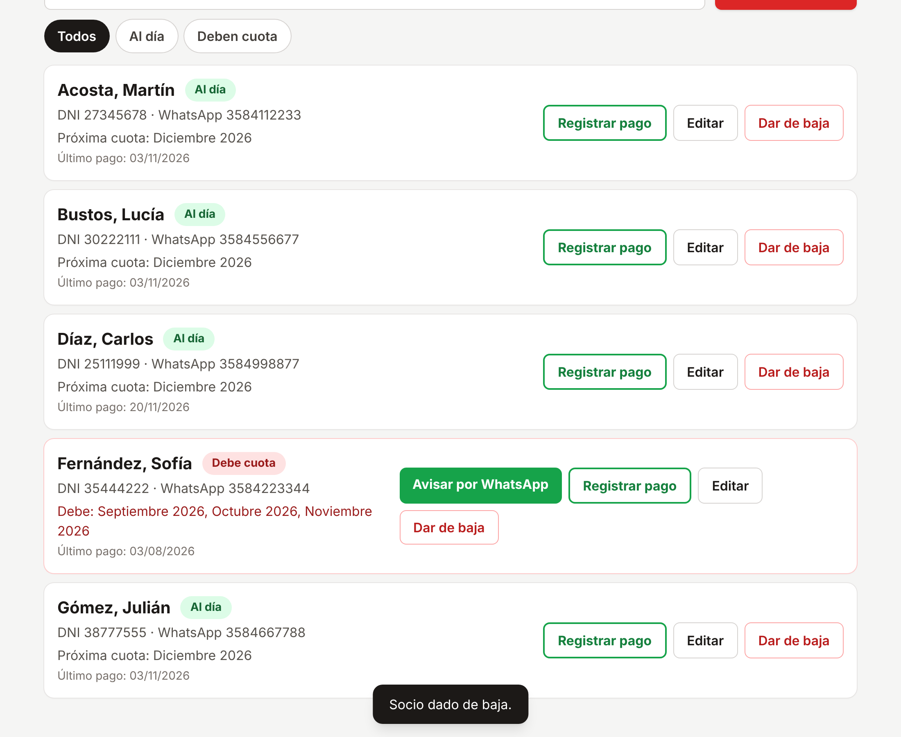
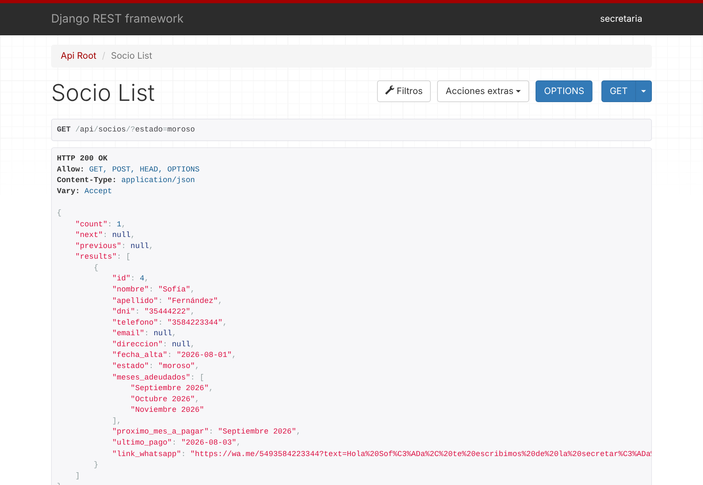
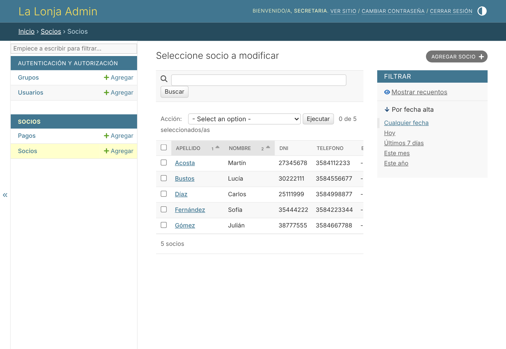
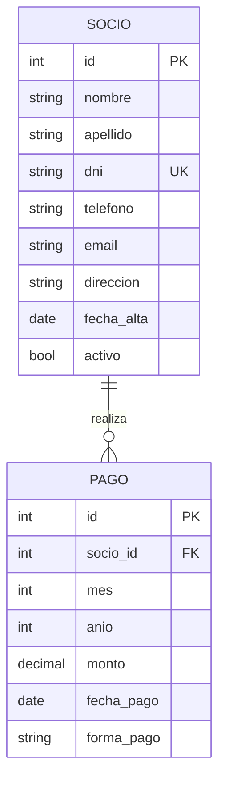

# ⚽ La Lonja

Sistema de **gestión de socios y cuotas** del Club La Lonja (C.A.L.L.), hecho con **Django** y **Django REST Framework**.
Lo usa la secretaría del club para dar de alta y de baja socios, controlar quién pagó la cuota del mes y avisar por WhatsApp a quien se atrasó.

> Proyecto de Django — Tecnicatura Superior en Desarrollo de Software, iTec Río Cuarto.

---

## 📖 Índice

1. [¿Qué es este proyecto?](#-qué-es-este-proyecto)
2. [Tecnologías](#-tecnologías)
3. [Capturas](#-capturas)
4. [Planificación de la base de datos](#-planificación-de-la-base-de-datos)
5. [Instalación paso a paso](#-instalación-paso-a-paso)
6. [Cómo usar el sistema](#-cómo-usar-el-sistema)
7. [Endpoints](#-endpoints)
8. [Filtros, búsqueda y paginación](#-filtros-búsqueda-y-paginación)
9. [Panel de administración](#-panel-de-administración)
10. [Estructura del proyecto](#-estructura-del-proyecto)
11. [Autor](#-autor)

---

## 🤔 ¿Qué es este proyecto?

El club necesita saber **quiénes son sus socios** y **si pagaron la cuota**. La cuota se paga **el día 3 de cada mes**. Cuando pasa esa fecha y un socio no pagó, la secretaria necesita avisarle.

El sistema tiene:

- Una **pantalla para la secretaria** (`/`), pensada para gente que no sabe de tecnología: botones grandes, todo en español, sin menús escondidos.
- Una **API REST** con la misma información en formato **JSON**, por si más adelante se conecta otra aplicación.

```json
{
  "id": 1,
  "nombre": "Carlos",
  "apellido": "Díaz",
  "estado": "moroso",
  "meses_adeudados": ["Octubre 2026", "Noviembre 2026"],
  "link_whatsapp": "https://wa.me/5493584998877?text=Hola%20Carlos..."
}
```

### ¿Cómo se sabe si un socio debe la cuota?

- La cuota de cada mes **vence el día 3** (se cambia en `DIA_VENCIMIENTO`, en `settings.py`).
- Un mes está **vencido** cuando ya pasó el día 3. Hasta el día 3 inclusive todavía no se considera atrasado.
- Un socio **debe** todos los meses vencidos, desde el mes en que se dio de alta, que no tengan un pago registrado.
- Los socios **inactivos** (dados de baja, con el casillero "Socio activo" destildado) conservan su historial pero **no figuran como deudores** ni se les ofrece el aviso.
- Si debe algo, aparece como **"Debe cuota"** y se habilita el botón **"Avisar por WhatsApp"**, que abre WhatsApp con el mensaje ya escrito y la lista de meses adeudados. La secretaria solo aprieta "Enviar".

---

## 🛠 Tecnologías


| Herramienta               | Para qué se usa                                                      |
| ------------------------- | --------------------------------------------------------------------- |
| **Python 3.13**           | Lenguaje del proyecto                                                 |
| **Django 6.1**            | Framework web: base de datos, panel de administración, vistas        |
| **Django REST Framework** | Convierte los modelos en una API (serializers, viewsets, paginación) |
| **SimpleJWT**             | Login con tokens (JWT) para la API                                    |
| **django-filter**         | Filtros en los listados (`?dni=30111222`)                             |
| **drf-spectacular**       | Documentación automática (Swagger y Redoc)                          |
| **django-cors-headers**   | Permite que un frontend externo se conecte a la API                   |
| **openpyxl**              | Genera el archivo Excel con la lista de socios                        |
| **Tailwind CSS**          | Estilos de la pantalla de la secretaria (se carga por CDN)            |
| **SQLite**                | Base de datos (un archivo, no hay que instalar nada)                  |
| **uv**                    | Gestor de entorno virtual y dependencias                              |

> La pantalla usa Tailwind desde su CDN, por eso necesita **internet** para verse con estilos.

---

## 📸 Capturas


| Pantalla de la secretaria          | API navegable                             |
| ---------------------------------- | ----------------------------------------- |
|  |  |


| Panel de administración                  |
| ----------------------------------------- |
|  |

---

## 🗂 Planificación de la base de datos

El sistema tiene **2 modelos propios** (más el `User` que trae Django para el login de la secretaria).

### Diagrama entidad-relación



### ¿Qué significa cada modelo?


| Modelo    | Qué representa                                                             | Se relaciona con      |
| --------- | --------------------------------------------------------------------------- | --------------------- |
| **Socio** | Persona asociada al club (activa o dada de baja)                            | Tiene muchos`Pago`    |
| **Pago**  | La cuota de un mes: monto, fecha y forma de pago (efectivo o transferencia) | Pertenece a un`Socio` |

Un socio **no puede tener dos pagos del mismo mes y año** (restricción única `socio + mes + anio`).
Si se da de baja a un socio, también se borran sus pagos (`on_delete=CASCADE`).

---

## 🚀 Instalación paso a paso

### Qué necesitás tener instalado

- **Python 3.13** o superior
- **uv** ([instrucciones](https://docs.astral.sh/uv/))
- **Git**

### Pasos

**1. Clonar el repositorio**

```bash
git clone https://github.com/Oyola2024/LaLonjaSocios
cd lalonja
```

**2. Instalar las dependencias** (uv crea el entorno virtual solo)

```bash
uv sync
```

**3. Entrar a la carpeta del código**

```bash
cd src
```

**4. Crear la base de datos** (aplica las migraciones)

```bash
uv run manage.py migrate
```

**5. Crear el usuario de la secretaria** (con el que se entra al sistema)

```bash
uv run manage.py createsuperuser
```

Te pide usuario, email y contraseña. Al escribir la contraseña no se ve nada en pantalla, es normal.

**6. Levantar el servidor**

```bash
uv run manage.py runserver
```

Listo. Abrí **http://127.0.0.1:8000/** en el navegador e ingresá con el usuario del paso 5.


| Qué                      | Dirección                              |
| ------------------------- | --------------------------------------- |
| Pantalla de la secretaria | http://127.0.0.1:8000/                  |
| Ingresos por mes          | http://127.0.0.1:8000/ingresos/         |
| API navegable             | http://127.0.0.1:8000/api/              |
| Swagger                   | http://127.0.0.1:8000/api/docs/swagger/ |
| Redoc                     | http://127.0.0.1:8000/api/docs/redoc/   |
| Administración           | http://127.0.0.1:8000/admin/            |

### Con Docker (opcional)

```bash
docker compose up --build
```

El contenedor aplica las migraciones y levanta el servidor en http://localhost:8000/. Para crear el usuario:

```bash
docker compose exec backend uv run python src/manage.py createsuperuser
```

### Tests

```bash
cd src
uv run manage.py test
```

---

## 🖥 Cómo usar el sistema

Entrá a `/` con el usuario de la secretaria (solo pueden entrar usuarios con "Staff status").


| Quiero...                                          | Cómo se hace                                                                                                                                      |
| -------------------------------------------------- | -------------------------------------------------------------------------------------------------------------------------------------------------- |
| Agregar un socio                                   | Botón**+ Nuevo socio**, completar el formulario y**Guardar**                                                                                      |
| Buscar un socio                                    | Escribir nombre, apellido o DNI en el buscador                                                                                                     |
| Ver quién debe cuota                              | Pestaña**Deben cuota** (o tocar el cuadro rojo de arriba)                                                                                         |
| Registrar que un socio pagó                       | **Registrar pago** → elegir el mes, la fecha, la forma de pago (efectivo o transferencia) y el monto. Viene sugerida la cuota más vieja que debe |
| Ver el historial de pagos                          | **Ver ficha** (o tocar el nombre del socio): muestra sus datos y todos sus pagos                                                                   |
| Bajar la lista de socios en Excel                  | **Descargar Excel**: baja lo que se ve (respeta la pestaña y el buscador)                                                                         |
| Ver cuánto se cobró cada mes                     | Menú**Ingresos**: tabla de los 12 meses, en efectivo y transferencia, por año                                                                    |
| Borrar un pago cargado por error                   | En la ficha,**Eliminar** al lado del pago                                                                                                          |
| Dejar de contar a un socio sin perder su historial | **Editar** y destildar **Socio activo** (después se lo ve en la pestaña **Inactivos**)                                                           |
| Avisarle a un socio que se atrasó                 | **Avisar por WhatsApp** (solo aparece si debe). Se abre WhatsApp con el mensaje escrito                                                            |
| Corregir datos de un socio                         | **Editar**                                                                                                                                         |
| Borrar un socio por completo                       | **Eliminar** y confirmar (borra también sus pagos)                                                                                                |

Para el WhatsApp, el teléfono se carga **con código de área y sin el 15** (ej: `3584123456`). El sistema agrega solo el código de Argentina.

El valor de la cuota que se sugiere al cobrar se cambia en `MONTO_CUOTA` (`src/settings/settings.py`).

### Acciones personalizadas (`@action`)

Además del CRUD normal hay dos endpoints especiales:


| Método | URL                       | Qué hace                                                                                                            |
| ------- | ------------------------- | -------------------------------------------------------------------------------------------------------------------- |
| `GET`   | `/api/socios/resumen/`    | Socios activos, cuántos están al día, cuántos deben cuota e inactivos                                            |
| `GET`   | `/api/socios/exportar/`   | Descarga los socios en un archivo Excel (acepta los mismos filtros del listado)                                      |
| `GET`   | `/api/pagos/ingresos/`    | Ingresos de cada mes de un año (`?anio=2026`), según la fecha de pago                                              |
| `POST`  | `/api/socios/{id}/pagar/` | Registra un pago (sin body: la cuota más vieja adeudada). Acepta`mes`, `anio`, `monto`, `fecha_pago` y `forma_pago` |

### Autenticación de la API

Todos los endpoints piden estar identificado: con **sesión** (si ya entraste a `/admin/`, la API navegable funciona directamente) o con **token JWT**:

```bash
# Pedir el token
curl -X POST http://127.0.0.1:8000/api/token/ \
  -H "Content-Type: application/json" \
  -d '{"username":"secretaria","password":"tuClave"}'
# → {"refresh": "...", "access": "eyJhbGciOi..."}

# Usarlo en cada pedido
curl http://127.0.0.1:8000/api/socios/ \
  -H "Authorization: Bearer <access>"
```

El token `access` dura 5 minutos. Se renueva con `POST /api/token/refresh/` mandando el `refresh`.

---

## 📍 Endpoints

Todos cuelgan de `/api/`. Cada recurso permite: `GET` (listar), `POST` (crear), `GET /{id}/` (ver uno), `PUT/PATCH /{id}/` (editar) y `DELETE /{id}/` (borrar).


| Recurso         | URL                                   |
| --------------- | ------------------------------------- |
| Socios          | `/api/socios/`                        |
| Pagos           | `/api/pagos/`                         |
| Token           | `/api/token/` y `/api/token/refresh/` |
| Esquema OpenAPI | `/api/schema/`                        |

---

## 🔎 Filtros, búsqueda y paginación

### Paginación

Los listados devuelven **20 resultados por página**. Para cambiar de página: `?page=2`.

```json
{
  "count": 45,
  "next": "http://127.0.0.1:8000/api/socios/?page=2",
  "previous": null,
  "results": [ ... ]
}
```

### Filtros y búsqueda en socios


| Qué querés                        | Ejemplo                                |
| ----------------------------------- | -------------------------------------- |
| Solo los que deben cuota            | `/api/socios/?estado=moroso`           |
| Solo los que están al día         | `/api/socios/?estado=al_dia`           |
| Solo los dados de baja (inactivos)  | `/api/socios/?estado=inactivo`         |
| Buscar por nombre, apellido o DNI   | `/api/socios/?search=perez`            |
| Apellido que contenga "per"         | `/api/socios/?apellido__icontains=per` |
| DNI exacto                          | `/api/socios/?dni=30111222`            |
| Ordenar por apellido (o`-apellido`) | `/api/socios/?ordering=apellido`       |

Se pueden combinar: `/api/socios/?estado=moroso&search=carlos`.

`GET /api/socios/{id}/` devuelve además el historial de pagos del socio. Los pagos se filtran por `socio`, `mes`, `anio` y `forma_pago`: `/api/pagos/?socio=1&anio=2026`.

---

## 🛡 Panel de administración

En **http://127.0.0.1:8000/admin/** se puede crear, ver, editar y borrar socios y pagos, y también crear nuevos usuarios para la secretaría (marcando "Staff status").

---

## 🧱 Estructura del proyecto

```
lalonja/
├── pyproject.toml        # dependencias del proyecto (uv)
├── uv.lock               # versiones exactas instaladas
├── .python-version       # versión de Python
├── Dockerfile
├── docker-compose.yml
├── README.md
└── src/
    ├── manage.py         # comandos de Django (runserver, migrate...)
    ├── settings/         # configuración del proyecto
    │   ├── settings.py   #   ajustes generales, DRF, CORS, JWT, día y monto de la cuota
    │   ├── urls.py       #   direcciones principales
    │   └── routers.py    #   registro de los endpoints de la API
    ├── socios/           # la app con toda la lógica
    │   ├── models.py     #   las tablas de la base de datos y la regla de la cuota
    │   ├── serializers.py#   convierten modelos a JSON y viceversa
    │   ├── views.py      #   pantalla principal y viewsets de la API
    │   ├── admin.py      #   configuración del panel de administración
    │   ├── tests.py      #   pruebas automáticas
    │   └── migrations/   #   historial de cambios de la base
    ├── templates/
    │   ├── base.html     # encabezado, menú, pie de página y funciones compartidas
    │   ├── home.html     # socios: listado y ficha (extiende de base.html)
    │   └── ingresos.html # ingresos de cada mes (extiende de base.html)
    └── static/
        └── escudo.jpg    # escudo del club
```

### Cómo se conecta todo

```
Pantalla (home.html, listado en `/` y ficha en `/socios/<id>/`) → API (/api/socios/) → urls.py → routers.py → ViewSet (views.py) → Serializer → Modelo → Base de datos
```

---

## 👥 Autor

- Facundo Oyola
